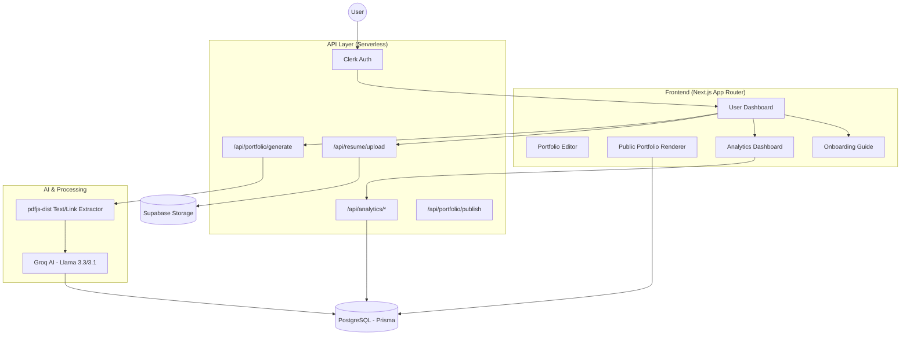

# High-Level Design (HLD) - ShortlistMe

ShortlistMe is an AI-powered portfolio generation platform designed to transform raw resumes into professional, shareable web portfolios instantly.

## System Architecture

ShortlistMe follows a modern serverless architecture built on the Next.js ecosystem.

## Core Components

### 1. Authentication (Clerk)
- Handles user registration, login, and session management.
- Integrated via middleware to protect dashboard and API routes.

### 2. Data Layer (Prisma & PostgreSQL)
- **Primary Database**: PostgreSQL hosted on Supabase.
- **ORM**: Prisma for type-safe database access.
- **Storage**: Supabase Buckets for hosting original PDF resume files.

### 3. AI Pipeline
- **Orchestration**: Next.js API Routes (`/api/portfolio/generate`).
- **Extraction**: `pdfjs-dist` for extracting raw text and scanning the annotation layer for embedded metadata (hyperlinks).
- **Inference**: Groq leveraging **Llama-3.3-70b** (primary) and **Llama-3.1-8b** (fallback/utility) for structured JSON mapping.

### 4. Rendering & Client Systems
- **Onboarding**: A multi-phase tour powered by `intro.js` that guides users through Dashboard, Studio, and Analytics.
- **Interactions**: Real-time event tracking for views and clicks, persisted via specialized analytics endpoints.
- **Portfolio Renderer**: SEO-optimized pages that dynamically map JSON data into premium UI themes.

## Data Flow (Resume to Portfolio)
1. **Upload**: User uploads PDF -> API saves to Supabase Storage -> Prisma records Resume metadata.
2. **Parsing**: API pulls PDF -> PDF.js extracts text + anchor links.
3. **Generation**: Text is sent to Groq -> AI returns structured JSON matching our `PortfolioVersion` schema.
4. **Customization**: User edits data in the dashboard -> Prisma updates the JSON draft.
5. **Deployment**: User clicks "Publish" -> Current draft is pinned as the `publishedVersion` and becomes public at `shortlist.me/[slug]`.
